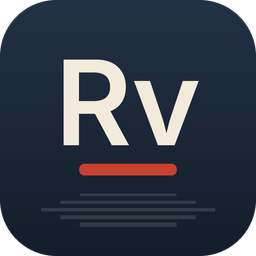

<p align="center">
  
</p>

<h1 align="center">Revela · Suíte FisiLab</h1>

<p align="center"><b>Revelação e catálogo de fotos</b></p>

<p align="center">Alternativa livre ao <b>Adobe Lightroom</b></p>

<p align="center">
Disponibilizado pelo <b>FisiLab — LARFIC · UFRGS</b> em parceria com o <b>CTA — Centro de Tecnologia Acadêmica</b>,
para estudantes, professores e técnicos da UFRGS.
</p>

---

O Revela faz parte da [Suíte FisiLab](https://github.com/mrcandrade/larfic/tree/main/suite-fisilab): programas
livres para ensino, pesquisa e criação na universidade. Ele é uma versão do
[LightCraft](https://github.com/storytold/lightcraft), um programa de código aberto escrito em Rust puro.

## O que faz

- **Catálogo de fotos**: Todas as Fotos, Adicionadas Recentemente, Escolhidas, Por Data, álbuns dentro de pastas e
  Excluídas Recentemente; estrelas de 0 a 5, bandeiras, rótulos de cor e uma busca que entende campos
  (`rating:>3 flag:pick iso:>800 date:2026-04 keyword:montanhas`).
- **Revelação não destrutiva**: os originais nunca são alterados. Exposição, contraste, realces, sombras, brancos e
  pretos; balanço de branco com conta-gotas; vibração, saturação, misturador de cores e rodas de gradação de cor;
  textura, claridade, remoção de névoa, vinheta e granulação; curva de tons paramétrica e por pontos.
- **Arquivos RAW sem bibliotecas em C**: decodificadores próprios para DNG, Canon CR2/CR3, Sony ARW, Nikon NEF,
  Fujifilm RAF (incluindo X-Trans), Panasonic RW2, Pentax PEF e Olympus ORF, além de JPEG, PNG, TIFF, WebP, PSD e
  JPEG XL (HEIC/HEIF opcional).
- **Máscaras**: pincel, gradientes linear e radial, faixas de luminância e de cor, céu, assunto e fundo, combináveis
  (somar, subtrair, interseção), com ajustes locais em cada máscara.
- **Predefinições e perfis**: dezoito predefinições incluídas, cada uma com controle de intensidade; salve as suas,
  copie, cole e sincronize ajustes entre várias fotos. Corte, endireitamento e preto e branco.
- **Rápido e privado**: tudo roda no seu computador, com processamento na placa de vídeo (wgpu: DX12, Vulkan,
  Metal) conferido contra a CPU. Edições independentes da resolução: a prévia e a exportação ficam iguais.
- **Importa catálogos do Lightroom Classic** e exporta para JPEG, PNG, TIFF, WebP, AVIF, JPEG XL, PSD e DNG.
- **Automação**: um canal de controle e um servidor MCP permitem que scripts e agentes de IA usem todos os comandos
  (`fisilab-revela-cli`).

## Instalação

### Windows

Baixe o instalador `FisiLab-Revela-Setup-<versão>.exe` no portal de downloads da Suíte FisiLab ou na página de
[Releases do GitHub](https://github.com/mrcandrade/fisilab-revela/releases) e execute-o. Depois, abra o **Revela** pelo
menu Iniciar. Na primeira execução, a interface já abre em português do Brasil, com a paleta original do LightCraft (opções **Noite** e **Dia**,
além de Midnight e Paper, em Configurações ▸ Interface).

### Compilar a partir do código

É preciso ter o [Rust](https://rustup.rs) instalado (no Windows, com as Build Tools do Visual Studio).

```sh
git clone https://github.com/mrcandrade/fisilab-revela
cd fisilab-revela
cargo run --release -p lightcraft                    # abre o Revela (o executável se chama fisilab-revela)
cargo run --release -p lightcraft -- ~/Fotos/viagem  # importa uma pasta de fotos
cargo run --release -p lightcraft-cli -- --help      # a ferramenta de linha de comando (fisilab-revela-cli)
```

Os nomes dos pacotes Cargo (`lightcraft`, `lightcraft-cli`) continuam os do projeto original; os executáveis gerados
são `fisilab-revela` e `fisilab-revela-cli`. Para abrir fotos HEIC/HEIF, compile com `--features lightcraft/heif`.

## Créditos

O Revela é baseado no [LightCraft](https://github.com/storytold/lightcraft), criado pela **ArtCraft Team e
contribuidores do LightCraft**, distribuído sob as licenças MIT ou Apache-2.0 ([LICENSE-MIT](LICENSE-MIT),
[LICENSE-APACHE](LICENSE-APACHE)), à sua escolha. As modificações do FisiLab — LARFIC/UFRGS seguem as mesmas licenças.

- Avisos de direitos autorais e materiais de terceiros: [NOTICE](NOTICE) e [assets/ATTRIBUTION.md](assets/ATTRIBUTION.md).
- O que foi alterado nesta versão: [MODIFICACOES.md](MODIFICACOES.md).
- O README original do projeto: [README.upstream.md](README.upstream.md).

Os nomes e marcas do projeto original (incluindo ArtCraft e LightCraft) pertencem aos seus donos. Esta versão não é
afiliada nem endossada por eles. Adobe e Lightroom são marcas da Adobe Inc., citadas apenas para comparação.

## Manifesto

Conhecimento produzido em uma universidade pública deve circular livremente, e as ferramentas que usamos para
ensinar, pesquisar e criar também devem ser livres. Leia o
[Manifesto pelas tecnologias livres](https://github.com/mrcandrade/larfic/blob/main/suite-fisilab/MANIFESTO.md).

---

<p align="center">
  <a href="https://www.ufrgs.br"></a>
  &nbsp;&nbsp;
  <a href="https://cta.if.ufrgs.br"></a>
  &nbsp;&nbsp;
  
</p>

<p align="center"><sub>FisiLab — LARFIC · UFRGS · em parceria com o CTA — Centro de Tecnologia Acadêmica</sub></p>
